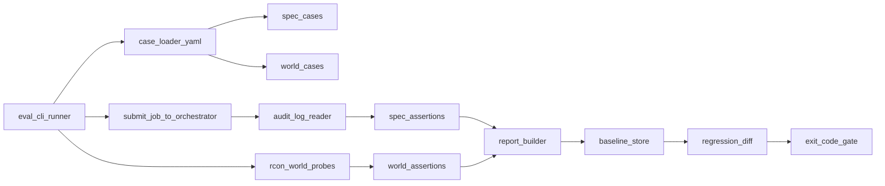
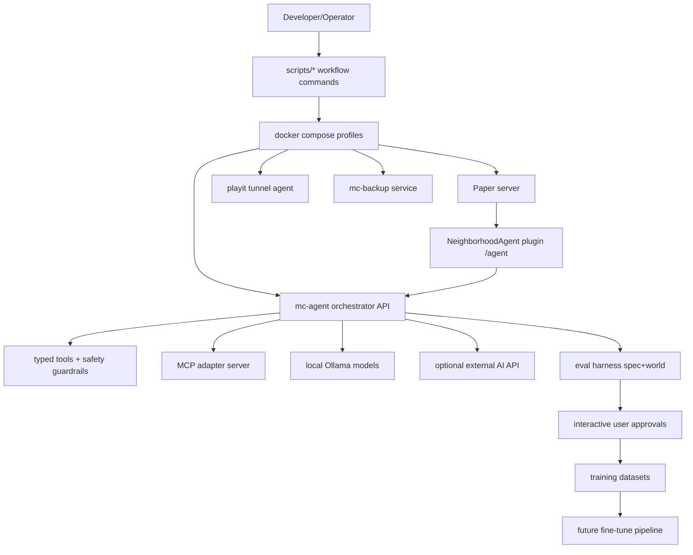

# Agent Eval Harness (Deterministic v1)

## Outcome

Deliver an eval system that answers: "Did this prompt/tool/model change make the agent better or worse?" with low-noise, repeatable metrics.

Non-negotiables:

- Deterministic enough for regression gating.
- Directly runnable from this repo with minimal setup.
- Broad day-one coverage of common Minecraft tasks.
- Explicit handling of flaky/non-deterministic cases.

## Determinism Contract

Before building the harness, lock down deterministic behavior behind an eval mode.

### Required controls

- **Eval mode flag**: `AGENT_EVAL_MODE=1`.
- **Model freeze**:
  - single model under test (`--model` or `AGENT_EVAL_MODEL`), no fallback chain during eval.
  - temperature forced to `0` in eval mode.
  - fixed `num_ctx` and `num_predict`.
- **Context freeze options**:
  - `AGENT_EVAL_DISABLE_RETRIEVAL=1` (default on for spec suite).
  - `AGENT_EVAL_DISABLE_DYNAMIC_CONTEXT=1` (removes volatile pieces like recent actions/timing noise for spec suite).
- **Timeout/step freeze**:
  - fixed per-case timeout and max steps.
  - deterministic failure classification (`timeout`, `model_error`, `tool_error`, `assertion_fail`, `flaky`).
- **Single-worker world execution**:
  - world mode always serial (`parallel=1`) to avoid world interference.

### File touchpoints for deterministic controls

- [agent/orchestrator.py](/Users/tyler/minecraft/neighborhood-server/agent/orchestrator.py)
- [agent/context.py](/Users/tyler/minecraft/neighborhood-server/agent/context.py)
- [agent/retrieval.py](/Users/tyler/minecraft/neighborhood-server/agent/retrieval.py)
- [agent/safety.py](/Users/tyler/minecraft/neighborhood-server/agent/safety.py)

## Harness Architecture

## Implementation Plan (File-by-file)

### 1) Eval core module

Create:

- [agent/eval/**init**.py](/Users/tyler/minecraft/neighborhood-server/agent/eval/__init__.py)
- [agent/eval/case.py](/Users/tyler/minecraft/neighborhood-server/agent/eval/case.py)
- [agent/eval/loader.py](/Users/tyler/minecraft/neighborhood-server/agent/eval/loader.py)
- [agent/eval/assertions.py](/Users/tyler/minecraft/neighborhood-server/agent/eval/assertions.py)
- [agent/eval/world.py](/Users/tyler/minecraft/neighborhood-server/agent/eval/world.py)
- [agent/eval/runner.py](/Users/tyler/minecraft/neighborhood-server/agent/eval/runner.py)

Responsibilities:

- `case.py`: strict Pydantic case schema and matcher DSL.
- `loader.py`: YAML discovery, validation, env substitution, filtering.
- `assertions.py`: deterministic assertion engine with structured failure reasons.
- `world.py`: sandbox lifecycle and world probes over existing RCON path.
- `runner.py`: orchestrate spec/world runs, reports, baseline diff, exit codes.

### 2) Case schema (strict)

Define a YAML schema with:

- `id`, `category`, `modes`, `prompt`, `context`, `expect`.
- Spec expectations:
  - `must_call`, `must_call_in_order`, `forbidden_tools`, `max_steps`, `status`, `model_prefix`.
- World expectations:
  - `blocks_present`, `blocks_absent`, `count_in_box_at_least`, `time_is`, `weather_is`, `player_not_buried`, `player_has_escape_path`.
- Stability metadata:
  - `determinism: strict|relaxed`.
  - `retries_allowed` (default 0 for strict).
  - `quarantine_reason` (optional).

### 3) Broad v1 case library (~50)

Create:

- [agent/eval/cases/build.yaml](/Users/tyler/minecraft/neighborhood-server/agent/eval/cases/build.yaml)
- [agent/eval/cases/dig.yaml](/Users/tyler/minecraft/neighborhood-server/agent/eval/cases/dig.yaml)
- [agent/eval/cases/fawe.yaml](/Users/tyler/minecraft/neighborhood-server/agent/eval/cases/fawe.yaml)
- [agent/eval/cases/world_settings.yaml](/Users/tyler/minecraft/neighborhood-server/agent/eval/cases/world_settings.yaml)
- [agent/eval/cases/player.yaml](/Users/tyler/minecraft/neighborhood-server/agent/eval/cases/player.yaml)
- [agent/eval/cases/queries.yaml](/Users/tyler/minecraft/neighborhood-server/agent/eval/cases/queries.yaml)
- [agent/eval/cases/safety.yaml](/Users/tyler/minecraft/neighborhood-server/agent/eval/cases/safety.yaml)

Must include hard regressions seen in this project:

- "fort around me" should not trap player (`player_not_buried=true`, escape path check).
- "in front of me" should place offset, not centered on player.
- unloaded chunk responses must fail, not pass.
- FAWE dispatch path must use real player context path (agentexec route).
- multi-tool intents: daylight+sunny, haste+day.

### 4) Sandbox and world probes

In [agent/eval/world.py](/Users/tyler/minecraft/neighborhood-server/agent/eval/world.py):

- Reserve deterministic sandbox box (env configurable).
- Pre-clean + post-clean each world case.
- Optional auto-teleport player to sandbox center for world cases.
- Probe API:
  - `get_block(x,y,z)`
  - `count_block_in_box(box, block)`
  - `is_player_buried(player)`
  - `has_escape_path(player, radius)`
  - `get_time_marker()`
  - `get_weather_state()`

### 5) Spec-mode implementation details

Spec run mechanics:

1. Submit `/v1/jobs` with `dry_run=true`.
2. Resolve audit row by `job_id` (strict, no timestamp heuristic if avoidable).
3. Assert tool trace with deterministic matcher engine.
4. Record per-case normalized result JSON.

Important: normalize argument maps (sorted keys) before diffing, so output is stable.

### 6) Baseline, diff, and gates

Artifacts:

- baseline: [agent/eval/baseline.json](/Users/tyler/minecraft/neighborhood-server/agent/eval/baseline.json)
- run reports: [data/eval-runs/](/Users/tyler/minecraft/neighborhood-server/data/eval-runs/)

Gate policy:

- `exit 0`: no regressions, no new flaky failures.
- `exit 2`: regressions vs baseline.
- `exit 3`: infra/environment failure (orchestrator unreachable, auth error, sandbox failure).

Regression diff dimensions:

- pass->fail / fail->pass by case id.
- tool trace drift for strict spec cases.
- step inflation beyond threshold.

### 7) Flake management policy (up front)

Add first-class flaky handling (do not hide flakes):

- Case can opt into `retries_allowed: 1..2` only if `determinism=relaxed`.
- If pass only after retry, mark `flaky_pass` and fail gate unless explicitly quarantined.
- Quarantine list file:
  - [agent/eval/quarantine.yaml](/Users/tyler/minecraft/neighborhood-server/agent/eval/quarantine.yaml)
- Quarantine entries require owner + reason + expiry date.

### 8) CLI and scripts

- Add wrapper script:
  - [scripts/eval.sh](/Users/tyler/minecraft/neighborhood-server/scripts/eval.sh)
- Add docs:
  - [agent/eval/README.md](/Users/tyler/minecraft/neighborhood-server/agent/eval/README.md)

CLI surface:

- `--mode spec|world|both`
- `--case`, `--category`
- `--player`, `--uuid`
- `--model`
- `--save-baseline`
- `--compare-baseline <path>`
- `--json-out <path>`
- `--fail-on-flaky`

## Directly-implementable milestone sequence

### Milestone A: deterministic substrate

- Add eval-mode freeze flags in orchestrator/context/retrieval.
- Validate with 3 smoke cases in spec mode.

Exit criteria:

- same 3 spec cases produce identical tool trace over 5 consecutive runs.

### Milestone B: harness core + 20 strict cases

- Implement runner, assertions, YAML loader, baseline writing.
- Add 20 strict cases across build/world_settings/safety.

Exit criteria:

- 100% pass on strict cases for 3 consecutive suite runs.

### Milestone C: world probes + full broad v1 (~50)

- Add sandbox and world assertions.
- Add all category files and anti-trap checks.

Exit criteria:

- world suite pass rate >= 90% and no untriaged flaky cases.

### Milestone D: regression gate ready

- Baseline committed.
- Report + diff + exit codes integrated.

Exit criteria:

- changing prompt/tool behavior intentionally causes deterministic fail in at least one relevant case.

## Risks and mitigations

- **Model nondeterminism**: freeze temperature/model; separate strict vs relaxed cases.
- **World contamination**: per-case cleanup + serial world execution.
- **Audit race conditions**: key by job id, bounded wait/poll.
- **Live-player interference**: use sandbox area and optional auto-teleport for eval runs.

## Acceptance checklist

- Case authoring requires no Python edits.
- Every historical failure mode from this thread is encoded as a permanent regression test.
- Suite output includes machine-readable JSON and human-readable summary.
- Re-running unchanged code against unchanged environment gives stable results.
- Team can tweak prompt/tools/models and see impact immediately.

## Out-of-scope for v1

- LLM-as-judge for text quality.
- Cross-model tournament runner.
- Full replay simulator without model calls.

## Locked decisions from user

- Build a **macro corpus** with the explicit objective of reaching near-complete coverage of common Minecraft intents ("100% coverage" as a guiding goal).
- Prefer **creative generation quality** over strict deterministic blueprints for end-user outputs.
- Add an **interactive validation lane** where a player can observe each generated outcome and approve/reject it.

## Plan refinement: Two-lane quality system

To balance creativity with testability, v1 uses two quality lanes:

1. **Automated deterministic lane (hard gate)**
   - Validates safety, correctness, tool usage, non-trap behavior, loaded-chunk behavior, and core world invariants.
   - Keeps regression control and CI signal stable.

2. **Interactive human lane (quality gate)**
   - Presents generated builds to the user for approve/reject with reasons.
   - Captures feedback into labeled artifacts for iterative prompt/tool tuning.

The automated lane prevents breakage; the interactive lane optimizes aesthetics and usefulness.

## Macro corpus roadmap (coverage-first)

Initial corpus groups:

- **Structures**: castle, house variants, towers, walls, gatehouses, courtyards, fountains
- **Terrain**: mountain, hill, lake, river, flatten, embankment
- **Infrastructure**: bridge, road, plaza, stairs, retaining walls
- **Nature**: forest clusters, groves, boulders, decorative terrain patches
- **Farms/Mobs**: fenced pens, spawn-pack macros (chickens), donkey farm presets
- **World utility**: lighting pass, pathing pass, cleanup pass, anti-trap recovery pass

Coverage is measured by intent taxonomy + pass rate, not by raw tool count.

## Interactive suite design (feasible v1 shape)

Use a lightweight review loop rather than fully automated visual judging:

- `eval world` run generates build in sandbox and emits `review_id`.
- Runner posts chat prompt: "Review `<review_id>`: /agent-review approve|reject <id> <reason>".
- Plugin captures review action and stores structured feedback (`review_id`, case_id, verdict, reason, timestamp).
- Reports include `auto_pass`, `human_verdict`, and disagreement flags.

This keeps the implementation practical while still enabling quality iteration on complex creative prompts.

## Determinism policy with creative outputs

- Keep **strict determinism** for safety/correctness assertions.
- Allow **bounded non-determinism** for creative shape/style outcomes.
- For creative cases, evaluate invariants (has wall perimeter, has gate opening, has fountain water source, no player burial) instead of exact block-for-block snapshots.
- Track variance score across repeated runs to prevent chaotic behavior.

## Additional acceptance criteria

- Macro corpus covers all high-priority intent families listed by the user.
- At least one "castle + fountain" gold case passes automated invariants and receives human approval in the interactive lane.
- Interactive review workflow is operational and captured in run artifacts.

## OSS product direction (locked)

### Chosen architecture

- **Repo strategy**: `mono_repo_first`
- **Model learning path**: collect preference data now, run **DPO later** after dataset quality/size thresholds are met.

### Monorepo domains to ship in v1

- `agent/` orchestrator, tool schemas, prompt/runtime logic
- `plugins/` Paper plugin(s), review command path, UX feedback hooks
- `macros/` open blueprint/macro corpus + metadata (versioned)
- `eval/` deterministic + interactive validation framework
- `datasets/` accepted/rejected review records and prompt-tool traces
- `training/` DPO-ready export scripts (no heavy training infra in v1)

### Macro corpus as open source library

Define each macro as a versioned contract:

- `id`, `version`, `intent_tags`, `required_inputs`, `optional_style_params`
- deterministic safety constraints (no trap, no unloaded chunks, bounds)
- expected invariant checks for eval (not exact block snapshots)
- compatibility metadata (Paper/FAWE/plugin versions)

Target output format:

- `macros/<category>/<name>.yaml` (declarative blueprint + compose steps)
- optional `macros/assets/*.schem` for curated structures

### Interactive validation data loop (v1)

Review flow:

1. Agent runs case/build and emits `review_id`.
2. Player issues review verdict (`approve` / `reject`) + reason.
3. System stores:
   - prompt/context
   - model + tool trace
   - world probes/invariants
   - review verdict + free-text reason
4. Data lands in append-only review log + normalized dataset rows.

Data artifacts:

- `datasets/reviews/raw/*.jsonl` (immutable events)
- `datasets/reviews/normalized/*.parquet` or jsonl
- `datasets/reviews/pairs/` (chosen/rejected pairs for future DPO)

### DPO-later readiness gates

Only start DPO when all are true:

- Minimum dataset size threshold reached (quality-filtered pairs).
- Rejection reasons taxonomy is stable.
- Automated eval baseline is green and stable for >= N runs.
- Holdout suite exists for offline model validation.

### Performance/cost/local model goals

- Keep inference local-first and small-model friendly.
- Use macro abstraction to reduce reasoning burden per request.
- Favor cheap deterministic tooling for correctness and reserve model creativity for design choices.

### Added acceptance criteria

- New macro can be added through declarative spec + tests, without touching core orchestrator code.
- Every accepted/rejected build is captured in dataset artifacts with reproducible IDs.
- Dataset export includes DPO pair generation script and quality filters.
- Eval suite can report quality by intent family (castle, terrain, infrastructure, mobs, farms).

## Product pivot: Open-source deployable template (locked)

This project is now scoped as a reusable, public template anyone can run locally or on a cheap VPS.

### Product promise

A user can clone the repo, configure a few env vars, and run an elite Minecraft stack with:

- Java + Bedrock crossplay
- remote connectivity from anywhere
- automated backups + restore path
- hardened default safety configs
- optional personal AI agent for in-game assistance
- observability and troubleshooting docs

### Target deployment profiles

- **Local laptop/dev mode** (single machine, quick start)
- **Cheap VPS mode** (small Linux host, remote friends)
- **Scale-up mode** (larger VPS / dedicated host)

### Template architecture tracks

1. **Server core track**
   - Docker Compose baseline for `mc`, `playit`, `backup`, `mc-agent`.
   - Java+Bedrock interoperability defaults (Geyser/Floodgate).
   - Safe performance presets by hardware tier.

2. **Operations track**
   - Backup/restore runbook with recovery drill.
   - Health checks, restart policies, and failure handling.
   - Cost/perf profiles (`small`, `medium`, `high`) with documented tradeoffs.

3. **Security track**
   - Secrets handling, minimal exposed ports, RCON isolation.
   - Safety guardrails for agent tools and destructive actions.
   - Optional allowlists/permissions templates for friend groups.

4. **AI augmentation track**
   - In-game `/agent` experience that is useful and safe by default.
   - Macro corpus + eval harness + review loop.
   - Local-model-first routing with bounded timeouts and fallback behavior.

5. **Template UX track**
   - One-command bootstrap path.
   - Guided setup docs for local and VPS deploy.
   - Troubleshooting cookbook keyed by common failures.

## Deliverables for v1 template release

- `README` split into:
  - quickstart (10-minute path)
  - VPS deployment (production-ish path)
  - operations (backups, updates, restore)
  - AI agent usage and safety
- `.env.example` profiles for hardware/cost tiers.
- `scripts/` bootstrap + verify scripts (preflight checks).
- `docs/` with architecture, security model, and runbooks.
- `eval` harness + baseline as quality gate for AI agent behavior.

## Success criteria (template-level)

- New user can deploy from zero on a cheap VPS and have friends join from Java+Bedrock.
- Backup restore drill is documented and repeatable.
- Agent can reliably perform common tasks and fails safely when uncertain.
- Total monthly cost and resource profile are transparent and tunable.
- Repo is cleanly open-source consumable (structure, docs, defaults, and examples).

## Revised milestone map

### Milestone 1: Template foundation

- Standardize compose stack and profile presets.
- Harden docs + bootstrap scripts for local/VPS.

### Milestone 2: Agent reliability + eval

- Deterministic eval harness + broad case library.
- Anti-regression gates + interactive review lane.

### Milestone 3: Macro corpus and quality lift

- Add high-value macro families (structures, terrain, infra, mobs/farms).
- Validate with automated + human review loops.

### Milestone 4: Public template polish

- Final docs, example configs, maintenance guide, versioned release tags.
- "share-with-friends" launch checklist.

## Implementation-ready release checklist

## Milestone 1: Template foundation (deployable stack)

### Files to create/update

- [/Users/tyler/minecraft/neighborhood-server/README.md](/Users/tyler/minecraft/neighborhood-server/README.md)
- [/Users/tyler/minecraft/neighborhood-server/docker-compose.yml](/Users/tyler/minecraft/neighborhood-server/docker-compose.yml)
- [/Users/tyler/minecraft/neighborhood-server/.env.example](/Users/tyler/minecraft/neighborhood-server/.env.example)
- [/Users/tyler/minecraft/neighborhood-server/scripts/bootstrap.sh](/Users/tyler/minecraft/neighborhood-server/scripts/bootstrap.sh)
- [/Users/tyler/minecraft/neighborhood-server/scripts/preflight.sh](/Users/tyler/minecraft/neighborhood-server/scripts/preflight.sh)
- [/Users/tyler/minecraft/neighborhood-server/scripts/verify-stack.sh](/Users/tyler/minecraft/neighborhood-server/scripts/verify-stack.sh)
- [/Users/tyler/minecraft/neighborhood-server/docs/deploy-local.md](/Users/tyler/minecraft/neighborhood-server/docs/deploy-local.md)
- [/Users/tyler/minecraft/neighborhood-server/docs/deploy-vps.md](/Users/tyler/minecraft/neighborhood-server/docs/deploy-vps.md)
- [/Users/tyler/minecraft/neighborhood-server/docs/ops-backup-restore.md](/Users/tyler/minecraft/neighborhood-server/docs/ops-backup-restore.md)

### Tasks

- Define profile presets (`small`, `medium`, `high`) for memory, view distance, simulation distance.
- Add one-command bootstrap path for local + VPS.
- Add preflight checks for Docker/ports/secrets/env completeness.
- Add verification script that confirms Java+Bedrock+playit+backup+agent health.
- Add backup restore drill with exact commands and validation steps.

### Done gate

- A clean machine can reach "friends connect from Java and Bedrock" using docs/scripts only.
- Backup restore drill succeeds end-to-end.

## Milestone 2: Agent reliability + deterministic eval core

### Files to create/update

- [/Users/tyler/minecraft/neighborhood-server/agent/orchestrator.py](/Users/tyler/minecraft/neighborhood-server/agent/orchestrator.py)
- [/Users/tyler/minecraft/neighborhood-server/agent/context.py](/Users/tyler/minecraft/neighborhood-server/agent/context.py)
- [/Users/tyler/minecraft/neighborhood-server/agent/retrieval.py](/Users/tyler/minecraft/neighborhood-server/agent/retrieval.py)
- [/Users/tyler/minecraft/neighborhood-server/agent/eval/**init**.py](/Users/tyler/minecraft/neighborhood-server/agent/eval/__init__.py)
- [/Users/tyler/minecraft/neighborhood-server/agent/eval/case.py](/Users/tyler/minecraft/neighborhood-server/agent/eval/case.py)
- [/Users/tyler/minecraft/neighborhood-server/agent/eval/loader.py](/Users/tyler/minecraft/neighborhood-server/agent/eval/loader.py)
- [/Users/tyler/minecraft/neighborhood-server/agent/eval/assertions.py](/Users/tyler/minecraft/neighborhood-server/agent/eval/assertions.py)
- [/Users/tyler/minecraft/neighborhood-server/agent/eval/world.py](/Users/tyler/minecraft/neighborhood-server/agent/eval/world.py)
- [/Users/tyler/minecraft/neighborhood-server/agent/eval/runner.py](/Users/tyler/minecraft/neighborhood-server/agent/eval/runner.py)
- [/Users/tyler/minecraft/neighborhood-server/agent/eval/README.md](/Users/tyler/minecraft/neighborhood-server/agent/eval/README.md)
- [/Users/tyler/minecraft/neighborhood-server/scripts/eval.sh](/Users/tyler/minecraft/neighborhood-server/scripts/eval.sh)
- [/Users/tyler/minecraft/neighborhood-server/agent/pyproject.toml](/Users/tyler/minecraft/neighborhood-server/agent/pyproject.toml)

### Tasks

- Add eval-mode deterministic controls (frozen model/temperature/timeouts/context toggles).
- Implement spec-mode assertions from audit entries keyed by `job_id`.
- Implement world-mode sandbox probes and serial execution.
- Add baseline file generation + regression diff + CI-friendly exit codes.
- Document flake policy and quarantine protocol.

### Done gate

- Spec suite yields stable traces across repeated runs.
- World suite catches known regressions (trap player, unloaded chunk false-success, bad FAWE dispatch).

## Milestone 3: Macro corpus + interactive review loop

### Files to create/update

- [/Users/tyler/minecraft/neighborhood-server/macros/README.md](/Users/tyler/minecraft/neighborhood-server/macros/README.md)
- [/Users/tyler/minecraft/neighborhood-server/macros/structures/\*.yaml](/Users/tyler/minecraft/neighborhood-server/macros/structures)
- [/Users/tyler/minecraft/neighborhood-server/macros/terrain/\*.yaml](/Users/tyler/minecraft/neighborhood-server/macros/terrain)
- [/Users/tyler/minecraft/neighborhood-server/macros/infrastructure/\*.yaml](/Users/tyler/minecraft/neighborhood-server/macros/infrastructure)
- [/Users/tyler/minecraft/neighborhood-server/macros/nature/\*.yaml](/Users/tyler/minecraft/neighborhood-server/macros/nature)
- [/Users/tyler/minecraft/neighborhood-server/macros/farms_mobs/\*.yaml](/Users/tyler/minecraft/neighborhood-server/macros/farms_mobs)
- [/Users/tyler/minecraft/neighborhood-server/plugins/neighborhood-agent/src/main/resources/plugin.yml](/Users/tyler/minecraft/neighborhood-server/plugins/neighborhood-agent/src/main/resources/plugin.yml)
- [/Users/tyler/minecraft/neighborhood-server/plugins/neighborhood-agent/src/main/java/com/neighborhood/agent/AgentReviewCommand.java](/Users/tyler/minecraft/neighborhood-server/plugins/neighborhood-agent/src/main/java/com/neighborhood/agent/AgentReviewCommand.java)
- [/Users/tyler/minecraft/neighborhood-server/plugins/neighborhood-agent/src/main/java/com/neighborhood/agent/NeighborhoodAgentPlugin.java](/Users/tyler/minecraft/neighborhood-server/plugins/neighborhood-agent/src/main/java/com/neighborhood/agent/NeighborhoodAgentPlugin.java)
- [/Users/tyler/minecraft/neighborhood-server/agent/prompts/system.md](/Users/tyler/minecraft/neighborhood-server/agent/prompts/system.md)

### Tasks

- Add macro spec contract (id/version/inputs/style/safety/invariants).
- Implement high-priority macro families (castle, terrain, bridge, forest, pens/farms).
- Add interactive `/agent-review approve|reject <review_id> <reason>` capture path.
- Persist review events with prompt, tool trace, and verdict metadata.
- Add gold-case flows like "castle + fountain" with invariant assertions.

### Done gate

- Complex prompts produce structured builds without trapping player.
- Interactive review path records accepted/rejected outcomes with reasons.

## Milestone 4: Dataset pipeline and DPO-later readiness

### Files to create/update

- [/Users/tyler/minecraft/neighborhood-server/datasets/reviews/raw/.gitkeep](/Users/tyler/minecraft/neighborhood-server/datasets/reviews/raw)
- [/Users/tyler/minecraft/neighborhood-server/datasets/reviews/normalized/.gitkeep](/Users/tyler/minecraft/neighborhood-server/datasets/reviews/normalized)
- [/Users/tyler/minecraft/neighborhood-server/datasets/reviews/pairs/.gitkeep](/Users/tyler/minecraft/neighborhood-server/datasets/reviews/pairs)
- [/Users/tyler/minecraft/neighborhood-server/training/export_reviews.py](/Users/tyler/minecraft/neighborhood-server/training/export_reviews.py)
- [/Users/tyler/minecraft/neighborhood-server/training/build_pairs.py](/Users/tyler/minecraft/neighborhood-server/training/build_pairs.py)
- [/Users/tyler/minecraft/neighborhood-server/training/quality_filters.py](/Users/tyler/minecraft/neighborhood-server/training/quality_filters.py)
- [/Users/tyler/minecraft/neighborhood-server/docs/training-dpo-readiness.md](/Users/tyler/minecraft/neighborhood-server/docs/training-dpo-readiness.md)

### Tasks

- Normalize review events into stable dataset schema.
- Generate chosen/rejected preference pairs for future DPO.
- Add quality filters (invalid runs, missing review reason, low-signal cases).
- Define readiness thresholds (dataset size, quality score, holdout performance).

### Done gate

- One command exports current review data into DPO-ready pair artifacts.
- DPO-start criteria are measurable and documented.

## Milestone 5: Public release polish

### Files to create/update

- [/Users/tyler/minecraft/neighborhood-server/LICENSE](/Users/tyler/minecraft/neighborhood-server/LICENSE)
- [/Users/tyler/minecraft/neighborhood-server/CONTRIBUTING.md](/Users/tyler/minecraft/neighborhood-server/CONTRIBUTING.md)
- [/Users/tyler/minecraft/neighborhood-server/CODE_OF_CONDUCT.md](/Users/tyler/minecraft/neighborhood-server/CODE_OF_CONDUCT.md)
- [/Users/tyler/minecraft/neighborhood-server/SECURITY.md](/Users/tyler/minecraft/neighborhood-server/SECURITY.md)
- [/Users/tyler/minecraft/neighborhood-server/docs/TROUBLESHOOTING.md](/Users/tyler/minecraft/neighborhood-server/docs/TROUBLESHOOTING.md)
- [/Users/tyler/minecraft/neighborhood-server/docs/RELEASE_CHECKLIST.md](/Users/tyler/minecraft/neighborhood-server/docs/RELEASE_CHECKLIST.md)

### Tasks

- Finalize OSS governance and contribution path.
- Add troubleshooting matrix for top startup/runtime failures.
- Publish release checklist and tag first template release.

### Done gate

- External user can deploy, verify, recover, and use `/agent` with no tribal knowledge.

## Cross-milestone quality gates

- No regressions in deterministic eval baseline.
- No critical security regressions (RCON exposure, unsafe defaults, secret leakage).
- Docs/scripts are sufficient for a first-time operator.

## Execution order recommendation

- Implement in strict order: Milestone 1 -> 2 -> 3 -> 4 -> 5.
- Do not start macro scale-out before deterministic eval gate is in place.
- Do not start DPO work before interactive review data is flowing and filtered.

## Efficient staged execution program (production-grade)

This section is the implementation master schedule optimized for stability, fast feedback, and low rollback risk.

### Program principles

- **Stability-first sequencing**: infra and observability before feature scale-out.
- **Small reversible changes**: each stage split into PR-sized slices with clear rollback points.
- **Gate-driven progression**: no stage starts until hard gates pass.
- **Operator-first DX**: every capability must be scriptable and documented.
- **Local-first cost model**: Ollama-first with optional external API fallback.

## Target stack blueprint

## Stage map (most efficient + stable order)

### Stage 0 - Repo standardization and controls

Goal: eliminate setup ambiguity and environment drift.

Deliverables:

- canonical repo contracts (`docs/ARCHITECTURE.md`, `docs/CONTRIBUTING_WORKFLOW.md`)
- environment contracts (`.env.example` with profiles and validation hints)
- script naming standard (`scripts/{stack,mc,agent,mcp,ollama,eval,train}-*.sh`)
- single `scripts/preflight.sh` that fails fast for missing deps/secrets/ports

Hard gate:

- Fresh machine can run preflight with actionable output only.

### Stage 1 - Core runtime platform (Minecraft + networking + backups)

Goal: production-like game server baseline before AI complexity.

Deliverables:

- Compose profiles: `core`, `core+playit`, `core+backup`
- Java+Bedrock interoperability defaults (Paper + Geyser + Floodgate)
- backup scheduling + restore drill script
- health checks + restart policies + log rotation guidance

Hard gate:

- Java and Bedrock clients join remotely through playit.
- Backup restore drill succeeds and is documented.

### Stage 2 - Agent runtime reliability and safety envelope

Goal: trustworthy `/agent` path with clear failure semantics.

Deliverables:

- stable plugin-to-orchestrator request flow
- deterministic tool error classification (no silent success)
- anti-loop and anti-trap protections
- model routing profile (Ollama primary, fallback behavior documented)

Hard gate:

- Known failure regressions are fixed and reproducible via tests.
- No unsafe default command paths.

### Stage 3 - Deterministic evaluation system (spec/world)

Goal: objective quality gating before macro expansion.

Deliverables:

- `agent/eval/` runner, schema, assertions, sandbox probes
- broad baseline case suite and regression diff output
- CI-friendly exit codes and flake policy

Hard gate:

- Stable pass/fail output over repeated runs.
- Regression detection catches intentionally introduced faults.

### Stage 4 - Macro corpus v1 (high-value intent coverage)

Goal: move from primitives to reliable complex outcomes.

Deliverables:

- `macros/` contract and versioning
- initial macro families: structures, terrain, infra, nature, mobs/farms
- system prompt/tool routing updated for macro-first planning
- anti-trap + spacing + loaded-area safety in macro execution

Hard gate:

- Gold prompts (castle+fountain, bridge, forest patch, animal pen) pass invariant checks.

### Stage 5 - Interactive review and dataset capture

Goal: human quality loop for creative outputs.

Deliverables:

- in-game review commands (`approve/reject` + reason)
- run artifact linking: prompt/context/tools/outcome/verdict
- normalized dataset and pair-builder for DPO-later

Hard gate:

- Review events flow into datasets with reproducible IDs and export works.

### Stage 6 - OSS template polish and release readiness

Goal: public-consumable template with elite DX.

Deliverables:

- polished README quickstarts (local + VPS + troubleshooting)
- governance files (`LICENSE`, `SECURITY`, `CONTRIBUTING`, `CODE_OF_CONDUCT`)
- release checklist and versioned tag process

Hard gate:

- New user can deploy, operate, recover, and run `/agent` without tribal knowledge.

## Parallel workstreams (safe concurrency)

- **WS-A Platform/Ops**: compose, scripts, backup, deploy docs.
- **WS-B Agent Core**: orchestrator/tool safety/runtime behavior.
- **WS-C Eval/Quality**: deterministic harness + baselines.
- **WS-D Macros/UX**: macro specs + prompt routing + in-game review UX.
- **WS-E Data/Training**: dataset normalization + pair generation.

Concurrency rules:

- WS-C must be in place before large WS-D expansion.
- WS-E starts once WS-D review events are stable.
- WS-A remains continuous across all stages.

## PR slicing strategy (to keep merges stable)

- PR1-PR3: Stage 0 contracts + preflight.
- PR4-PR8: Stage 1 compose/profile and backup restore workflow.
- PR9-PR14: Stage 2 agent reliability fixes.
- PR15-PR22: Stage 3 eval core + baseline.
- PR23-PR35: Stage 4 macro families (small batches by family).
- PR36-PR42: Stage 5 review/dataset pipeline.
- PR43-PR48: Stage 6 OSS polish and release packaging.

Each PR requires:

- updated docs for any user-visible behavior change
- verification commands in PR description
- rollback note if touching runtime critical path

## Workflow scripting matrix (elite DX)

Add/standardize scripts:

- **Stack lifecycle**
  - `scripts/stack-up.sh [profile]`
  - `scripts/stack-down.sh`
  - `scripts/stack-logs.sh [service]`
  - `scripts/stack-verify.sh`
- **Minecraft ops**
  - `scripts/mc-op.sh <player>`
  - `scripts/mc-gamemode.sh <mode> [player]`
  - `scripts/mc-backup-now.sh`
  - `scripts/mc-restore.sh <backup-file>`
- **Agent/MCP**
  - `scripts/agent-health.sh`
  - `scripts/agent-smoke.sh`
  - `scripts/mcp-health.sh`
- **Model routing**
  - `scripts/ollama-check.sh`
  - `scripts/ollama-pull-recommended.sh`
  - `scripts/agent-model-profile.sh <local|hybrid|cloud>`
- **Quality/testing**
  - `scripts/test-unit.sh`
  - `scripts/eval-spec.sh`
  - `scripts/eval-world.sh --player <name>`
  - `scripts/eval-diff.sh`
- **Data/training prep**
  - `scripts/review-export.sh`
  - `scripts/review-build-pairs.sh`
  - `scripts/train-readiness-report.sh`

## Reliability and security SLOs

Operational SLO targets:

- stack startup success >= 99% on supported hosts
- backup job success >= 99%
- agent request success (non-user-error) >= 95%
- mean agent response for common prompts <= 15s (local profile)

Security defaults:

- no public RCON exposure
- secrets loaded from file/env only (never committed)
- denylist + confirm-token path for destructive operations
- least-privilege plugin command exposure

## Verification gates by stage

- **Gate A (post Stage 1)**: connectivity + backups verified.
- **Gate B (post Stage 2)**: agent reliability smoke suite passes.
- **Gate C (post Stage 3)**: deterministic eval baseline established.
- **Gate D (post Stage 4)**: macro gold-cases pass.
- **Gate E (post Stage 5)**: review dataset pipeline validated.
- **Gate F (post Stage 6)**: external-user dry run succeeds.

## Definition of "production grade" for this template

- reproducible deployment
- documented disaster recovery
- explicit safety envelope
- objective quality regression gates
- clear operator workflows
- cost/performance profiles for consumer and VPS hardware

## Compute portability requirement (locked)

All core workflows must run on:

- local consumer hardware (laptop/desktop)
- remote VPS/dedicated server

This includes serving, evaluation, dataset export, and fine-tuning prep/execution.

### Environment matrix

- **Env A: local-cpu**
  - baseline dev + eval + dataset workflows
  - supports small-model inference and lightweight training experiments
- **Env B: local-gpu**
  - accelerated Ollama inference and optional fine-tuning profile
- **Env C: remote-vps-cpu**
  - production server runtime and remote eval
  - optional external model API if local model serving is too heavy
- **Env D: remote-gpu-server**
  - full local-model inference + fine-tuning workloads at scale

## Docker profile strategy

Add compose profiles for portability:

- `profile core`: minecraft + playit + backup
- `profile agent`: orchestrator + MCP adapter
- `profile model-local`: Ollama local model service
- `profile model-remote`: external API config (no local model container)
- `profile eval`: deterministic eval runner container
- `profile train`: fine-tuning/training-prep container

### Fine-tuning container (required)

Introduce a dedicated train container with reproducible toolchain and mounts:

- image/runtime contains:
  - Python + training deps
  - dataset tooling
  - optional lightweight PEFT/DPO stack
- mounts:
  - `datasets/`
  - `training/`
  - `artifacts/` (checkpoints, logs, reports)
- execution modes:
  - `train-export` (build cleaned datasets)
  - `train-pairs` (build DPO pairs)
  - `train-dryrun` (sanity checks, no heavy compute)
  - `train-run` (actual fine-tune if hardware allows)

## Scripted portability workflows

Add scripts that hide host differences:

- `scripts/profile-local.sh` (local defaults)
- `scripts/profile-vps.sh` (vps defaults)
- `scripts/profile-train.sh` (training env setup)
- `scripts/train-up.sh` / `scripts/train-down.sh`
- `scripts/train-export.sh`
- `scripts/train-dryrun.sh`
- `scripts/train-run.sh`

Each script must detect environment capability and fail with actionable messages.

## Capability detection and fallbacks

- Detect GPU availability and choose appropriate training/inference profile.
- If no GPU:
  - keep inference on small local models or external API fallback
  - allow training pipeline dry-run and dataset prep only
- If low RAM/CPU:
  - downshift model/context defaults automatically

## Portability acceptance gates

- **Gate P1 (local)**: stack + agent + eval-spec + dataset export runs on local CPU-only machine.
- **Gate P2 (vps)**: core server stack + agent runs on remote VPS with documented resource floor.
- **Gate P3 (train env)**: training container launches and completes `train-dryrun` on both local and VPS.
- **Gate P4 (full train where capable)**: at least one end-to-end fine-tune run succeeds on GPU-capable host.

## Resource-tier guidance (documented)

Publish minimum/recommended specs for:

- gameplay-only
- gameplay + local agent inference
- gameplay + eval world suite
- gameplay + training-prep
- full fine-tune runs

Include estimated monthly VPS cost bands and expected performance tradeoffs.
