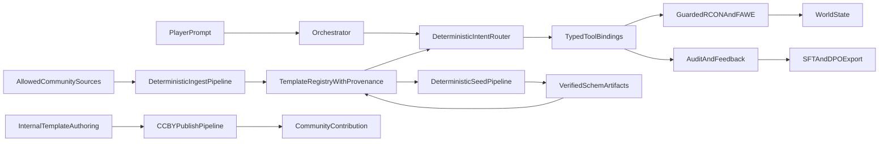

# Deterministic Community-First Builder Stack

## Goal

Deliver a fully deterministic `tools -> commands -> world edits` pipeline where AI is strictly an orchestrator of typed tools, while maximizing leverage of open community templates and contributing internal templates back under CC-BY.

### Non-negotiables

- **Inbound licensing**: permissive-only (`CC0`, `CC-BY`, `CC-BY-SA`, permissive OSS where applicable). Reject NC/ND/restricted.
- **Outbound contribution**: publish internal templates under **CC-BY** with attribution metadata.
- **Deterministic orchestration**: no raw FAWE freeform for core paths; typed tool bindings are primary.
- **Programmatic validation**: schema validation, command validation, and world-state validation as CI gates.

## Production vision (elite target)

This project is explicitly designed to become the **de facto Minecraft MCP builder platform**:

- A production-grade server stack where any AI client can reliably world-edit via typed MCP tools.
- A shared template ecosystem combining internal and community assets with strict provenance.
- A deterministic tool runtime that prevents prompt-level chaos from corrupting the world.
- A publish/ingest loop that compounds quality over time and gives back to the community.

## Strategy pivot (platform-first)

To reduce delivery risk and accelerate production readiness, this plan now follows:

1. **MCP Core v1 first** (stable public contract + deterministic executor).
2. **Template Pack Spec second** (ecosystem interface for community content).
3. **Gold corpus third** (~50 high-confidence templates).
4. **Federated ingestion and scale-up fourth** (to 250+ with strict policy).
5. **Publish-back loop fifth** (CC-BY outbound packs).

This keeps the long-term vision intact while avoiding up-front complexity and source-specific fragility.

## Platform principles

- **MCP-first interface**: MCP contracts are the canonical public API; chat orchestration is an adapter.
- **Deterministic-by-default**: identical tool input yields identical command output and bounded world effects.
- **Composable quality**: templates + typed primitives + validation, not raw freeform command generation.
- **Open ecosystem**: ingest permissive community packs; publish internal packs under CC-BY.
- **Operator-safe**: destructive ops gated, auditable, reversible where possible.

## Architecture

## Reference architecture layers

### Layer 1: Protocol/API

- MCP tool contracts + schema versioning
- Backward-compatible contract evolution policy
- Capability discovery endpoint (tool availability + server feature flags)

### Layer 2: Runtime/Execution

- Typed tool dispatcher with runtime schema checks
- Guarded RCON/FAWE execution
- Deterministic command signatures and execution envelopes
- Sandbox-aware world mutation controls

### Layer 3: Content system

- Template registry with provenance and content hashes
- Community ingestion allowlist + quarantine
- Internal authoring + seed/verify promotion pipeline
- Outbound publish pipeline (CC-BY)

### Layer 4: Intelligence/orchestration

- Intent routing to template vs parametric paths
- Deterministic rewrite rules and fallback logic
- Feedback capture, quality labels, and training export

### Layer 5: Trust/operations

- CI gates for schema/commands/world-state
- Drift detection and release baselines
- Audit, attribution, and compliance artifacts
- Rollback and disaster recovery workflows

## Phase 1 - Deterministic source manifests and ingestion contracts

Add:

- [agent/templates/sources.yaml](agent/templates/sources.yaml)
- [agent/templates/license_policy.yaml](agent/templates/license_policy.yaml)
- [agent/templates/ingest_manifest.schema.json](agent/templates/ingest_manifest.schema.json)

`sources.yaml` must include, per source:

- `source_id`, `name`, `url`
- `license` (must match allowlist)
- `attribution_template`
- `format` (`schem` / `litematic` / mixed)
- `version_pin` (tag/commit hash)
- `enabled` boolean

Deterministic ingestion rules:

- Reject any source without explicit compatible license.
- Reject mutable `main`/`latest` ingestion; require pinned ref.
- Deterministic ID normalization: `source_id + slug + variant`.
- Stable category/complexity mapping from declared manifest, not inferred heuristically.

## Phase 2 - Typed tool-schema bindings as the core interface

In [agent/tool_registry.py](agent/tool_registry.py) and [agent/tools.py](agent/tools.py):

- Add full FAWE typed primitives (selection, transforms, motion, shaping, generation, history).
- Add runtime JSON-schema argument validation before `execute_tool` dispatch.
- Keep raw `fawe_as_player` as escape hatch only.
- Add strict enum constraints for directions/rotations/modes.

Binding contract:

- Every typed tool must map to exactly one deterministic command template or bounded command sequence.
- Every tool must emit structured execution metadata: `tool`, `commands`, `block_estimate`, `deterministic_signature`.

## Phase 3 - Deterministic template/provenance model

Extend template model in [agent/templates/catalog.py](agent/templates/catalog.py) and [agent/templates/catalog.json](agent/templates/catalog.json):

- Existing fields + new required provenance fields:
  - `source_id`, `source_url`, `source_ref`
  - `license`, `author`, `attribution`
  - `complexity` (`basic|common|complex`)
  - `content_hash` (hash of `.schem` or normalized fallback recipe)
  - `deterministic_seed_version`
- Add `fallback_steps` with safe `${anchor +/- n}` resolver.
- Validate `fallback` / `fallback_steps` tool names at catalog load.

## Phase 4 - Corpus ingestion target (~250 permissive community templates)

Target split:

- `basic`: 100
- `common`: 100
- `complex`: 50

Category spread (minimums):

- `farm` 35
- `house` 45
- `fortress` 35
- `infrastructure` 35
- `decoration` 45
- `utility` 30
- `nature_terrain` 25

Ingestion output artifacts:

- `agent/templates/catalog.json` (normalized entries)
- `agent/templates/ingested/` (staged source metadata)
- `agent/templates/quarantine/` (rejected/ambiguous items)
- `agent/templates/ATTRIBUTION.md` (generated credits)

## Phase 5 - Deterministic seed + world verification pipeline

Add:

- [agent/templates/seed.py](agent/templates/seed.py)
- [scripts/seed-templates.sh](scripts/seed-templates.sh)

Pipeline per template:

1. Place seed player in isolated sandbox.
2. Build via fallback recipe if `.schem` absent.
3. Save schematic using FAWE and copy to repo.
4. Re-paste saved schematic.
5. Verify expected footprint and anchor markers.
6. Compute and persist `content_hash`.

Modes:

- `--missing-only`
- `--source <source_id>`
- `--category <category>`
- `--complexity <tier>`
- `--verify-only`

Safety:

- Auto `backup_now` for batches.
- Refuse when live players are inside sandbox radius.

## Phase 6 - Router and audit as deterministic orchestrator layer

In [agent/orchestrator.py](agent/orchestrator.py):

- Expand rewrite sets so template intents consistently land on `paste_template_at_player`.
- Preserve parametric path only for explicit constraints.
- Add deterministic routing fields to every job:
  - `intent_family`
  - `selected_tool`
  - `selected_template_id`
  - `fallback_reason`
  - `rewrite_applied`
  - `source_id`
  - `content_hash`

In [agent/feedback.py](agent/feedback.py) and [agent/training/feedback.py](agent/training/feedback.py):

- Include full routing/provenance metadata in feedback/export rows.

## Phase 7 - Deterministic validation gates (schema -> tool -> command -> world)

Strengthen eval and tests:

- Add command-fixture gate (tool calls + exact command sequence).
- Add world-fixture gate for seeded templates (anchor blocks / footprint checks).
- Expand coverage matrix for new primitives and template families.
- Require baseline traces for strict cases; keep relaxed cases isolated.

Primary files:

- [tests/test_schema_tools.py](tests/test_schema_tools.py)
- [tests/test_tools.py](tests/test_tools.py)
- [tests/test_templates.py](tests/test_templates.py)
- [tests/test_orchestrator_contract.py](tests/test_orchestrator_contract.py)
- [tests/test_training_feedback.py](tests/test_training_feedback.py)
- [agent/eval/cases/](agent/eval/cases/)
- [agent/eval/coverage.yaml](agent/eval/coverage.yaml)
- [agent/eval/fixtures/gate.spec.json](agent/eval/fixtures/gate.spec.json)

## Phase 8 - Community contribution workflow (CC-BY outbound)

Add deterministic publish flow:

- Internal build -> `create_template_from_selection` -> metadata enrichment -> quality gate -> publish bundle.
- Publish bundle includes:
  - `.schem`
  - metadata JSON
  - attribution and changelog
  - `CC-BY` license notice

Add docs + scripts for submitting template packs back upstream.

## Phase 9 - Documentation and governance

Update:

- [docs/TEMPLATES.md](docs/TEMPLATES.md)
- [agent/knowledge/fawe.md](agent/knowledge/fawe.md)
- [agent/knowledge/patterns.md](agent/knowledge/patterns.md)
- [agent/prompts/system.md](agent/prompts/system.md)
- [.cursor/rules/02-minecraft-tools.mdc](.cursor/rules/02-minecraft-tools.mdc)

New docs:

- [docs/TEMPLATE_INGESTION_POLICY.md](docs/TEMPLATE_INGESTION_POLICY.md)
- [docs/DETERMINISTIC_VALIDATION.md](docs/DETERMINISTIC_VALIDATION.md)
- [docs/COMMUNITY_PUBLISHING.md](docs/COMMUNITY_PUBLISHING.md)

## MCP productization requirements (de facto standard path)

### Public contract requirements

- Stable tool naming and argument semantics across releases.
- Explicit deprecation lifecycle with migration notes.
- MCP compatibility matrix by server version/plugin version.
- Capability flags for optional features (templates, seed, publish, eval lanes).

### Reliability requirements

- P95 tool call latency SLOs for common operations.
- Retry policy taxonomy (safe retry vs non-idempotent).
- Failure envelope standard (`error_code`, `cause`, `retryable`, `operator_action`).

### Multi-user/server requirements

- Workspace/world namespace support for multiple servers.
- Role-aware permissions for build/admin/publish actions.
- Per-world template catalogs and shared global catalogs.

### Security requirements

- Hard denylist for dangerous raw commands.
- Confirm-token enforcement for high-risk operations.
- Signed provenance manifests for ingested/published templates.

### Ecosystem requirements

- Template pack import/export format spec (`pack.json` + `.schem` bundle).
- Attribution bundle format for redistribution.
- Community contribution guide and quality bar checklist.

## Implementation order (ready-to-execute)

1. MCP Core v1 contract freeze (`tool_registry`, schema docs, compatibility policy).
2. Deterministic executor boundary (`schema -> tool -> command` validation/signature envelope).
3. Template Pack Spec + validator (`pack.json`, SPDX, attribution, hashes, capability metadata).
4. Seed/verify pipeline wired to pack validator and deterministic sandbox checks.
5. Gold corpus (~50 templates) ingestion + verification + strict route coverage.
6. Routing/audit/feedback/training metadata hardening with provenance fields.
7. Community ingestion federation (allowlist sources, pinned refs, quarantine).
8. Scale corpus to 250+ with category/tier minima and CI drift gates.
9. CC-BY publish-back pack pipeline + governance docs.

## Deterministic binding contracts (must implement exactly)

### Tool binding table (typed tool -> command template)

- `select_box` -> `//pos1 x,y,z` then `//pos2 x,y,z`
- `expand_selection` -> `//expand <amount> <direction>`
- `contract_selection` -> `//contract <amount> <direction>`
- `selection_size` -> `//size` (parsed structured output)
- `set_selection` -> `//set <pattern>`
- `replace_in_selection` -> `//replace <from_blocks> <to_pattern>`
- `walls_in_selection` -> `//walls <pattern>`
- `faces_in_selection` -> `//faces <pattern>`
- `hollow_selection` -> `//hollow <thickness> <pattern>`
- `overlay_selection` -> `//overlay <pattern>`
- `stack_selection` -> `//stack <count> <direction>`
- `move_selection` -> `//move <amount> <direction>`
- `rotate_selection` -> `//rotate <yaw>`
- `flip_selection` -> `//flip <direction>`
- `copy_selection` -> `//copy`
- `cut_selection` -> `//cut`
- `paste_selection_at_player` -> `//paste` or `//paste -a`
- `generate_pyramid_at_player` -> `//pyramid` or `//hpyramid`
- `generate_forest_at_player` -> `//forestgen <size> <tree_type> <density>`
- `smooth_selection` -> `//smooth <iterations>`
- `naturalize_selection` -> `//naturalize`
- `undo` -> `//undo <count>`
- `redo` -> `//redo <count>`

Contract requirements:

- Command string format must be deterministic for identical args.
- Every tool returns `commands` and `deterministic_signature`.
- Signatures are used in eval fixtures and drift checks.

## Ingestion manifest contract (exact schema)

Each source in `sources.yaml` must include:

- `source_id`
- `display_name`
- `source_type` (`git_repo` | `release_archive`)
- `source_url`
- `source_ref` (immutable commit/tag/hash)
- `license_spdx`
- `license_url`
- `allowed_for_ingest` (bool)
- `attribution_required` (bool)
- `attribution_template`
- `format` (`schem` | `litematic` | `mixed`)
- `category_map` (source path/tag -> canonical category)
- `complexity_map` (source metadata -> `basic|common|complex`)
- `enabled` (bool)

Each ingested template row must include:

- `id`, `title`, `category`, `complexity`, `tags`, `aliases`
- `schematic`, `footprint`, `max_blocks`, `distance_default`
- `source_id`, `source_url`, `source_ref`
- `license`, `author`, `attribution`
- `content_hash`, `deterministic_seed_version`
- `fallback` and/or `fallback_steps`

## Acceptance criteria (definition of done)

### A. Deterministic tool layer

- All new typed FAWE tools are present in registry and dispatch.
- Runtime schema validation rejects invalid/malformed tool args before execution.
- `tests/test_schema_tools.py` and `tests/test_tools.py` cover all new bindings.

### B. Deterministic template corpus

- `catalog.json` contains 250 templates with required provenance fields.
- 100% of rows pass strict license policy (`permissive-only`).
- `ATTRIBUTION.md` generated from catalog and matches source manifests.

### C. Deterministic world verification

- Seed pipeline verifies every template in sandbox mode.
- Verification records include anchor/footprint checks and `content_hash`.
- CI gate fails on hash drift for strict cases.

### D. Orchestrator as pure tool conductor

- Routing picks typed tools/templates for all covered intents.
- Audit/feedback include routing + provenance + fallback metadata.
- Training export carries deterministic metadata needed for SFT/DPO.

### E. Community contribution backflow

- Internal template publishing emits CC-BY metadata bundle.
- Publish workflow documented and scriptable.
- Outbound attribution/changelog generated automatically.

## Rollout strategy

1. Ship typed tool bindings + runtime schema validation first.
2. Ingest/seed `basic` tier and lock deterministic gates.
3. Ingest/seed `common` tier and extend eval coverage.
4. Ingest/seed `complex` tier with stricter sandbox checks.
5. Turn on fail-on-drift for strict template routes by default.

## Appendix A - v1 source allowlist draft

This appendix defines the initial **community-first** ingestion set and what is explicitly excluded.

### A1. Accepted inbound licenses (v1)

- `CC0-1.0`
- `CC-BY-4.0`
- `CC-BY-SA-4.0`
- `MIT` (only when the actual schematic assets are explicitly licensed, not just code tooling)

### A2. Rejected inbound licenses (v1)

- Any `NC` variant (`CC-BY-NC*`)
- Any `ND` variant (`CC-BY-ND*`)
- Missing/ambiguous/noassertion license
- Terms that block redistribution or derivative works

### A3. Candidate source set (draft)

All entries below are **draft allowlist candidates**; ingestion is enabled only after verification checklist passes.

#### Include-candidate (pending verification)

- `erg_world_structures`
  - URL: `https://github.com/ERGeorgiev/minecraft-schematics-world-structures`
  - Expected license: `MIT`
  - Expected format: `.schem`
  - Expected role: broad real-world structure corpus
  - Status: `pending_verification`

- `craftmatic_gallery`
  - URL: `https://github.com/tribixbite/craftmatic`
  - Expected license: `MIT` (tooling) + explicit asset attribution checks required
  - Expected format: generated `.schem`
  - Expected role: procedurally generated baseline templates
  - Status: `pending_verification`

#### Explicitly excluded (v1 deny examples)

- `katorlys_springtime_spawn`
  - URL: `https://github.com/katorlys/SpringtimeSpawn`
  - Observed terms: `CC-BY-NC-ND-4.0`
  - Decision: `rejected_license_policy`

- `minecraft_schematics_site_generic`
  - URL: `https://www.minecraft-schematics.com/`
  - Reason: per-item licensing variability / non-deterministic redistribution terms
  - Decision: `rejected_until_item_level_license_manifest`

### A4. Per-source verification checklist (must pass before enable=true)

For each candidate source, generate `agent/templates/sources/<source_id>.yaml` with:

1. Immutable source pin (`commit_sha` or release digest).
2. License proof path (`LICENSE` file or explicit per-asset license doc).
3. Asset scope proof (license applies to schematic files, not code only).
4. Attribution requirements parsed into normalized fields.
5. Redistribution/derivative rights validated against policy.
6. Format validation sample (`.schem` load test on at least 3 assets).
7. Hash inventory of ingestable artifacts.
8. Category/complexity mapping rules frozen.

If any check fails, source is moved to:

- `agent/templates/quarantine/<source_id>/`
- with machine-readable `rejection_reason`.

### A5. Deterministic corpus assembly plan to reach 250

The 250-template target is built from four deterministic lanes:

1. `community_verified_basic` (priority first)
2. `community_verified_common`
3. `community_verified_complex`
4. `community_seeded_promotions` (internal templates created from tool fallback flows, then published back under CC-BY)

Rules:

- Community lanes always preferred over internal seeded templates.
- Internal seeded templates are used only to close category/tier gaps.
- Every internal seeded promotion must include outbound `CC-BY` metadata bundle.

### A6. Publication back to community (CC-BY)

For each promoted internal template:

- Export package: `.schem`, metadata JSON, preview image, changelog, attribution file.
- Attach SPDX/license metadata: `CC-BY-4.0`.
- Include `source: neighborhood-server internal` + author credits.
- Maintain publish ledger in:
  - `agent/templates/published/index.json`
  - `agent/templates/published/CHANGELOG.md`

### A7. Required deliverable before implementation starts

Before writing code, finalize:

- `sources.yaml` with at least **10 verified enabled sources** or an approved reduced v1 ingestion target.
- A deterministic inventory projection showing source-by-source contributions to the 250 target.

## Appendix B - Source inventory projection (draft)

This projection is the planning baseline. Counts are estimates until each source passes verification and manifest pinning.

### B1. Coverage target recap

- `basic`: 100
- `common`: 100
- `complex`: 50
- total: 250

### B2. Source contribution plan (draft IDs)

- `erg_world_structures`
  - projected: `basic 20`, `common 25`, `complex 15` (total 60)
  - strength: civic/landmark structures, varied scales
  - risk: low-to-medium (single maintainer, must confirm asset-scope license)

- `craftmatic_gallery`
  - projected: `basic 25`, `common 20`, `complex 10` (total 55)
  - strength: deterministic procedural variants, high normalization consistency
  - risk: medium (tool license vs generated artifact license clarity)

- `verified_pack_03` (placeholder until verified)
  - projected: `basic 12`, `common 10`, `complex 5` (total 27)
  - strength: farms/utilities
  - risk: unknown pending license verification

- `verified_pack_04` (placeholder until verified)
  - projected: `basic 8`, `common 12`, `complex 8` (total 28)
  - strength: houses/settlements
  - risk: unknown pending license verification

- `verified_pack_05` (placeholder until verified)
  - projected: `basic 10`, `common 12`, `complex 6` (total 28)
  - strength: infrastructure and roads/bridges
  - risk: unknown pending license verification

- `verified_pack_06` (placeholder until verified)
  - projected: `basic 6`, `common 8`, `complex 10` (total 24)
  - strength: fortress/castle components
  - risk: unknown pending license verification

- `verified_pack_07` (placeholder until verified)
  - projected: `basic 7`, `common 6`, `complex 5` (total 18)
  - strength: decoration/plaza/statues
  - risk: unknown pending license verification

- `verified_pack_08` (placeholder until verified)
  - projected: `basic 4`, `common 5`, `complex 4` (total 13)
  - strength: nature/terrain set pieces
  - risk: unknown pending license verification

Projected subtotal from external sources: 253

### B3. Deterministic eligibility filter math

To avoid overpromising, actual usable count is computed as:

- `usable = discovered - duplicate_ids - license_rejections - format_failures - verification_failures`

Where:

- `duplicate_ids` are collisions after deterministic ID normalization.
- `license_rejections` are any non-permissive/ambiguous assets.
- `format_failures` are `.schem` parse/load failures.
- `verification_failures` are world-footprint/hash mismatches after seed verify.

### B4. Minimum pass thresholds before locking v1

- At least `250` usable templates after filter math.
- At least `95%` of templates must pass seed verify on first run.
- At least `1` verified source per major category:
  - `farm`, `house`, `fortress`, `infrastructure`, `decoration`, `utility`, `nature_terrain`
- No category allowed below these minimum usable counts:
  - `farm >= 30`
  - `house >= 40`
  - `fortress >= 30`
  - `infrastructure >= 30`
  - `decoration >= 40`
  - `utility >= 25`
  - `nature_terrain >= 20`

### B5. Gap-closure policy if external corpus undershoots

If usable external templates are below target:

- First: add more permissive verified sources (never relax license policy).
- Second: generate deterministic internal templates only for missing category/tier gaps.
- Third: publish those internal templates back out under `CC-BY` and track in publish ledger.

### B6. Implementation checkpoint gates

- Gate 1 (pre-code): at least 3 verified sources with pinned refs and license proofs.
- Gate 2 (mid-ingest): at least 120 usable templates with category minimums proportionally met.
- Gate 3 (pre-seed full): at least 250 usable templates normalized and deduplicated.
- Gate 4 (release): 250 seeded/verified templates + deterministic eval gates passing.

## Appendix C - Milestone schedule (M1..M6)

### M1 - Core deterministic tool runtime

Deliverables:

- Typed FAWE primitive bindings + runtime schema validation.
- Deterministic command signatures in all tool results.
- Contract tests and command fixture gate expanded.

Exit criteria:

- 100% new tool schemas covered by tests.
- Command drift gate passing on CI.

### M2 - Ingestion policy + source verification

Deliverables:

- `sources.yaml`, policy engine, quarantine flow, attribution generation.
- At least 3 verified permissive sources pinned.

Exit criteria:

- License gate rejects all non-permissive test fixtures.
- Source verification checklist machine-enforced.

### M3 - First production corpus (basic tier)

Deliverables:

- > =100 basic templates ingested, normalized, and routable.
- Seed/verify pipeline operational for missing `.schem`.

Exit criteria:

- > =95% first-pass verify success in sandbox.
- Category minima for basic tier achieved.

### M4 - Full corpus completion

Deliverables:

- Full 250 template corpus across basic/common/complex.
- Provenance and content hash complete for all entries.

Exit criteria:

- 250 usable templates after deterministic filter math.
- No unresolved license/provenance exceptions.

### M5 - Orchestrator + feedback intelligence

Deliverables:

- Hardened deterministic routing and fallback metadata wiring.
- Training export enriched with provenance and deterministic signatures.

Exit criteria:

- Contract evals pass for all primary intent families.
- Feedback rows contain required routing+source fields.

### M6 - MCP productization + community publishing

Deliverables:

- Public MCP capability docs + compatibility matrix.
- CC-BY publish pipeline for internal templates.
- Governance docs for contribution and release management.

Exit criteria:

- End-to-end demo: ingest -> route -> world edit -> publish back.
- Production readiness checklist fully green.

## Appendix D - Production readiness checklist (Go/No-Go)

Use this checklist as the release bar before claiming production-grade/de facto MCP status.

### D1. Contract and compatibility gates

- [ ] `TOOLS_VERSION` and schema docs updated for this release.
- [ ] All MCP tool schemas validate and are backward-compatible (or have documented migration path).
- [ ] Capability matrix published (server version x plugin version x feature flags).
- [ ] Deprecations have explicit sunset versions and replacement mappings.

Go/No-Go rule:

- Any unresolved breaking contract change without migration docs = **No-Go**.

### D2. Deterministic execution gates

- [ ] Runtime schema validation enforced before tool dispatch.
- [ ] Deterministic command signature emitted for every tool call.
- [ ] Command fixture gate passes with zero drift in strict lane.
- [ ] World verification lane passes for strict template/tool cases.

Go/No-Go rule:

- Any strict-lane drift or unverifiable world edit path = **No-Go**.

### D3. Safety and security gates

- [ ] Confirm-token enforcement active for destructive operations.
- [ ] Raw command denylist tested and enforced.
- [ ] Role/permission boundaries verified for build/admin/publish actions.
- [ ] No secret leakage in logs, audit records, or publish bundles.

Go/No-Go rule:

- Any bypass of destructive confirms or secrets exposure = **No-Go**.

### D4. Template corpus and licensing gates

- [ ] > = 250 usable templates after deterministic filter math.
- [ ] 100% inbound assets pass permissive-only license policy.
- [ ] Provenance fields complete for every template.
- [ ] `ATTRIBUTION.md` and source manifests generated and consistent.
- [ ] Quarantine flow active for rejected/ambiguous assets.

Go/No-Go rule:

- Any template without verified license/provenance = **No-Go**.

### D5. Seed and verification gates

- [ ] Seed pipeline supports missing-only and verify-only deterministic modes.
- [ ] > = 95% first-pass verify success in sandbox for current corpus.
- [ ] Failed seed/verify outputs include machine-readable failure causes.
- [ ] Content hashes recorded for all seeded templates.

Go/No-Go rule:

- If verify rate < 95% for release corpus, or hash records missing = **No-Go**.

### D6. Orchestrator and feedback intelligence gates

- [ ] Deterministic rewrite rules pass contract tests for all core intent families.
- [ ] Routing metadata fields fully populated (`intent_family`, `selected_tool`, `selected_template_id`, `fallback_reason`, `rewrite_applied`, `source_id`, `content_hash`).
- [ ] Feedback export rows include required routing/provenance fields.
- [ ] Training export smoke test passes with current data schema.

Go/No-Go rule:

- Missing required routing/provenance fields in audit/feedback exports = **No-Go**.

### D7. Reliability and operations gates

- [ ] P95 latency SLOs met for top 10 most-used tools.
- [ ] Retry policy behavior validated for transient vs non-idempotent errors.
- [ ] Backup/restore drill completed for world and template artifacts.
- [ ] Incident runbook tested (tool outage, FAWE failure, ingest rejection storm).

Go/No-Go rule:

- Failed backup/restore drill or missing incident runbook validation = **No-Go**.

### D8. Community publish-back gates (CC-BY)

- [ ] Outbound templates package includes `.schem`, metadata, attribution, changelog, and `CC-BY-4.0` notice.
- [ ] Publish ledger updated (`published/index.json`, `published/CHANGELOG.md`).
- [ ] Contributor workflow documented and reproducible.
- [ ] At least one successful end-to-end publish-back run executed in staging.

Go/No-Go rule:

- If publish pipeline cannot produce compliant CC-BY bundle = **No-Go**.

### D9. Final release decision protocol

Release is **Go** only when:

- All checklist items are green, and
- No open `No-Go` findings remain, and
- CI strict lanes + staging E2E scenario pass in the same release window.

If any item fails:

- Open a blocking issue with owner + ETA.
- Tag release as `rc` and keep production claim disabled.

## Appendix E - MCP Core v1 contract (depth + breadth)

This appendix defines the semver-locked public MCP surface for v1 so ecosystem clients can build confidently.

### E1. Contract strategy

- **Depth**: each capability family has enough primitives for real production workflows.
- **Breadth**: coverage spans status/admin/world/edit/template/publish domains.
- **Stability**: v1 names and parameter semantics are frozen; additive-only within v1 minor releases.

### E2. Capability tiers

- `core.required`: required for any server claiming MCP Core v1 compliance.
- `core.plus`: recommended for production quality and deterministic editing.
- `ecosystem.optional`: optional extension set (publish/ingest extras).

Servers must expose capability flags so clients can adapt.

### E3. Semver-locked tool families

#### 1) Status/inspection (`core.required`)

- `server_status`
- `preflight`
- `list_players`
- `get_player_position`
- `get_player_dimension`

#### 2) Safety/admin/world controls (`core.required`)

- `backup_now`
- `set_time`
- `set_weather`
- `set_gamemode`
- `teleport_player`
- `say`

#### 3) Baseline build/edit (`core.required`)

- `fill_box`
- `clear_box`
- `build_platform`
- `build_sphere`
- `build_cylinder`
- `build_spiral_staircase`

#### 4) Deterministic player-relative builders (`core.plus`)

- `build_house_at_player`
- `build_castle_at_player`
- `build_animal_pen_at_player`
- `build_bridge_at_player`
- `build_wall_at_player`
- `mine_shaft_at_player`

#### 5) Typed FAWE primitives (`core.plus`)

- selection: `select_box`, `select_around_player`, `expand_selection`, `contract_selection`, `selection_size`
- transforms: `set_selection`, `replace_in_selection`, `walls_in_selection`, `faces_in_selection`, `hollow_selection`, `overlay_selection`
- motion/clipboard: `stack_selection`, `move_selection`, `rotate_selection`, `flip_selection`, `copy_selection`, `cut_selection`, `paste_selection_at_player`
- shaping/generation/history: `generate_pyramid_at_player`, `generate_forest_at_player`, `smooth_selection`, `naturalize_selection`, `undo`, `redo`

#### 6) Template ecosystem (`core.plus`)

- `list_templates`
- `paste_template_at_player`
- `create_template_from_selection`

#### 7) Inventory/mobs (`core.plus`)

- `give_item`
- `give_haste`
- `summon_entity`

#### 8) Escape hatches (`ecosystem.optional`)

- `fawe_as_player`
- `run_command`

Requirement: escape hatches must be policy-guarded and never required for normal quality workflows.

### E4. Standard argument constraints

Core v1 requires:

- strict JSON object schemas (`additionalProperties=false`)
- bounded numeric ranges for coordinates/radii/heights/counts
- normalized enums for direction/rotation/modes
- explicit nullable fields where null is semantically allowed

### E5. Standard result envelope

Every tool result must include:

- `ok` (bool)
- `tool` (string)
- `output` (human-readable summary)
- `commands` (ordered command list)
- `block_estimate` (int)
- `error` (nullable string)
- `deterministic_signature` (hash of normalized tool+args+command plan)
- `execution_metadata`:
  - `policy_path` (`typed|fallback|escape_hatch`)
  - `safety_level`
  - `world_namespace`
  - `server_capability_version`

### E6. Compatibility and evolution policy

- **v1 minor**: additive only (new optional args with defaults, new tools behind capabilities).
- **v1 patch**: bugfix only, no semantic behavior drift for same args.
- **v2 major**: any breaking rename/argument semantic change.

Deprecation protocol:

1. mark deprecated in schema docs with replacement tool/arg
2. keep functional for >=2 minor versions
3. remove only in next major

### E7. Breadth profile targets for compliant servers

A production server claiming "MCP Core v1 + Plus" must satisfy:

- all `core.required` tools
- > =90% `core.plus` tools
- template ecosystem enabled (`list/paste/create`)
- deterministic validation lanes enabled (`schema`, `command`, `world`)

### E8. Conformance test suite requirements

Define `mcp-core-v1-conformance` suite:

- schema conformance tests
- command-shape fixture tests
- deterministic replay tests (same input -> same signature)
- world-state assertions for representative edits
- safety-policy enforcement tests

Certification levels:

- `core-v1-certified`
- `core-v1-plus-certified`
- `core-v1-plus-ecosystem-certified`

### E9. Extension mechanism (without fragmentation)

Extensions must use namespaced tool IDs:

- `x_<vendor>_<tool>`

Rules:

- cannot shadow core tool names
- must publish schema + docs + migration notes
- must declare capability flag

This preserves innovation while keeping a stable de facto standard.
