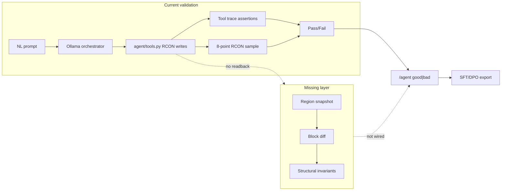
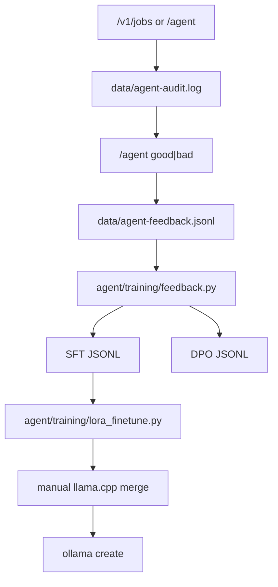
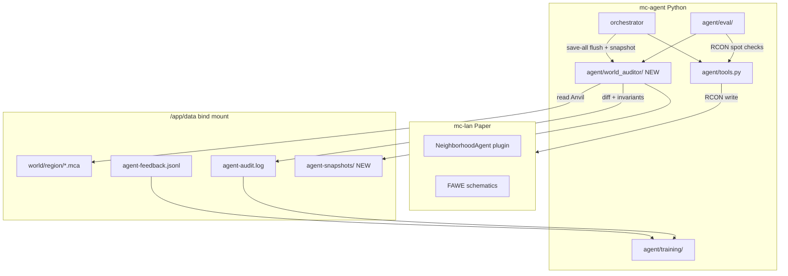

# World Observability vs Current Validation

## Verdict: right ideas, wrong transport layer

The proposed stack (Carpet + Scarpet + MiniHUD + Masa Gadget) is excellent **world observability** design — but it targets **Fabric client/server**, not your stack. Your server is **Paper 26.1** ([`docker-compose.yml`](docker-compose.yml) `TYPE: PAPER`). Carpet, Scarpet, MiniHUD, and Masa Gadget **cannot load** on Paper. Switching to Fabric to get them would break Geyser/Floodgate crossplay, FAWE, and the existing NeighborhoodAgent plugin.

What _does_ transfer directly:

| Proposed capability                 | Paper-native equivalent                                             |
| ----------------------------------- | ------------------------------------------------------------------- |
| Scarpet region scans / block counts | Python Anvil parser + new typed tools                               |
| Carpet spawn/structure diagnostics  | RCON `execute if entity` + optional Paper plugin events             |
| MiniHUD visual debug                | Out-of-game: heatmap JSON + optional Spectator TP in eval sandboxes |
| Amulet offline auditing             | **Best fit**: read `data/world/` from `mc-agent` bind mount         |
| Regression snapshots / diffs        | New `agent/world_auditor/` service                                  |
| JSON telemetry export               | Extend audit row schema in [`agent/safety.py`](agent/safety.py)     |

The Amulet + Python NBT route is the strongest match for your goal: **programmatic, verifiable world edits from natural language**.

---

## What you validate today (and where it breaks)



### Layer 1 — Tool trace (strong)

[`agent/eval/assertions.py`](agent/eval/assertions.py) and [`agent/eval/corpus_assertions.py`](agent/eval/corpus_assertions.py) assert: required tools, forbidden tools, call order, arg subsets, max steps. This catches **routing mistakes** ("used `build_house` instead of `paste_template`") reliably.

### Layer 2 — Live world probes (weak)

[`agent/eval/probes.py`](agent/eval/probes.py) `template_built` samples **8 offsets** against a generic palette; pass threshold is often `min_matches: 1` ([`agent/eval/corpus/animal_pens.yaml`](agent/eval/corpus/animal_pens.yaml)). A coop passes if one fence/oak_planks block appears near the anchor. No wall-perimeter, roof, gate, entity-count, or volume checks.

[`scripts/full_validation.py`](scripts/full_validation.py) pastes every catalog template and records tool success + schematic-vs-fallback — **no shape inspection**.

[`agent/eval/cases/`](agent/eval/cases/) world suite is mostly player-safety (`player_not_buried`, `player_has_escape_path` in [`agent/eval/world.py`](agent/eval/world.py)); no structural cases yet.

### Layer 3 — Feedback/training (partially wired, missing ground truth)



- Feedback rows store `prompt`, `tool_names`, `rating` — **not** full tool args/results (join via `job_id` to audit) and **not** any world-state evidence ([`agent/feedback.py`](agent/feedback.py)).
- DPO pairs need clustered good+bad on same prompt; sparse real-user feedback often yields **zero pairs**.
- LoRA runner exists; GGUF merge + Ollama redeploy is **manual** ([`docs/FINE_TUNING.md`](docs/FINE_TUNING.md) lines 61-78).
- [`comprehensive_world_editing` plan Phase 7](.cursor/plans/comprehensive_world_editing_57d94ba4.plan.md) already names the missing gate: **schema → tool → command → world** — world is the unfinished step.

**Bottom line:** you can prove the agent _called the right tool_ far more reliably than you can prove it _built the right thing_. For "verifiably produces correct world edits via NL," the world layer is the bottleneck — not the LLM routing layer.

---

## Recommended architecture (Paper-native observability)



### Core principle: three verification tiers

1. **Fast (RCON, per-probe, &lt;1s):** `execute if block`, entity presence, player safety — keep and extend [`agent/eval/world.py`](agent/eval/world.py).
2. **Medium (RCON scan, seconds):** `count_blocks_in_box`, `palette_histogram`, `entity_count_in_box` — new typed tools wrapping batched `execute if block` for bboxes ≤ ~500 blocks.
3. **Deep (Anvil snapshot/diff, post-job):** full region parse after `save-all flush`; compute palette diff, added/removed blocks, structural invariants — new `agent/world_auditor/`.

Use tier 1+2 in corpus eval for fast CI loops; tier 3 on every production job (or eval sandbox job) to populate audit/feedback with objective evidence.

---

## Phase 1 — World auditor module (highest leverage)

**New package:** `agent/world_auditor/`

| Module          | Responsibility                                                                                                                                                     |
| --------------- | ------------------------------------------------------------------------------------------------------------------------------------------------------------------ |
| `snapshot.py`   | Given `Box(x1,y1,z1,x2,y2,z2)`, RCON `save-all flush`, read affected `.mca` chunks from `/app/data/world/`, return `{block_id: count}` + optional sparse block map |
| `diff.py`       | `before` vs `after` → `{added, removed, changed}` palettes + volume delta                                                                                          |
| `invariants.py` | Pluggable checks: `wall_perimeter`, `has_gate_opening`, `no_floating_blocks`, `entity_count`, `min_palette_coverage`, `footprint_filled_ratio`                     |
| `hash.py`       | Stable region content hash for regression baselines (feeds template `content_hash` from comprehensive plan Phase 5)                                                |

**Dependency:** add `amulet-core` or `anvil-parser2` to [`agent/pyproject.toml`](agent/pyproject.toml). Prefer parsing from the bind mount inside `mc-agent` (already has `/app/data`).

**Safety gate:** refuse snapshot if live players are inside the bbox (reuse sandbox isolation logic from corpus runner). Always `backup_now` before eval batches that mutate sandboxes.

**Orchestrator hook** ([`agent/orchestrator/app.py`](agent/orchestrator/app.py)):

- Before first mutating tool call on a job: capture `before` snapshot of job bbox (infer bbox from tool args or sandbox cell allocation).
- After last tool call: capture `after`, compute diff + invariants.
- Append to audit row:

```json
"world_verification": {
  "bbox": [x1,y1,z1,x2,y2,z2],
  "palette_added": {"minecraft:oak_fence": 42, ...},
  "palette_removed": {"minecraft:grass_block": 18, ...},
  "invariants": [{"name": "wall_perimeter", "ok": true}, ...],
  "content_hash": "sha256:...",
  "verified_ok": true
}
```

---

## Phase 2 — Extend eval harness with real structural probes

Upgrade [`agent/eval/probes.py`](agent/eval/probes.py) and corpus YAML schema:

**New probe types:**

- `palette_histogram` — assert min/max counts per block type in bbox
- `count_block_in_box` — exact count (already planned in eval harness plan, not implemented)
- `entity_count_in_box` — exact mob count, not just presence
- `structural_check` — delegate to `invariants.py` (`wall_perimeter`, `gate_width`, `roof_coverage`)
- `region_hash_matches` — regression baseline for seeded templates

**Tighten existing corpus thresholds:** raise `min_matches` on `template_built` from 1 to template-specific floors once structural probes exist. Start with [`agent/eval/corpus/animal_pens.yaml`](agent/eval/corpus/animal_pens.yaml) as the pilot category.

**Add typed inspection tools** to [`agent/tools/_monolith.py`](agent/tools/_monolith.py) (read-only, guardrailed bbox cap):

- `count_blocks_in_box(block, x1, y1, z1, x2, y2, z2)`
- `palette_in_box(x1, y1, z1, x2, y2, z2)`
- `verify_structure(check, x1, y1, z1, x2, y2, z2)` — exposes invariants to LLM + MCP

This gives the in-game `/agent` the same observability Cursor MCP gets — critical for self-correction loops.

---

## Phase 3 — Close the training feedback loop

Wire `world_verification` into [`agent/training/feedback.py`](agent/training/feedback.py):

- **SFT metadata:** attach `world_verification` summary to `meta` so the model learns tool-call → expected palette patterns.
- **Auto-negative mining:** jobs where `verified_ok=false` but user didn't rate → synthetic `bad` rows with reason from failed invariant (feeds DPO without waiting for users).
- **User rating as correction:** `/agent good` on a `verified_ok=false` job → flag as "subjective override" in meta (valuable DPO signal: user liked it despite probe failure).
- **Corpus DPO expansion:** pass/fail from eval + world diff becomes `chosen`/`rejected` pairs automatically ([`agent/training/build_datasets.py`](agent/training/build_datasets.py)).

**Deploy automation** (currently the weakest link):

- Add `scripts/merge-lora-to-gguf.sh` wrapper around llama.cpp `convert-lora-to-gguf`
- Extend [`agent/training/ollama_register.py`](agent/training/ollama_register.py) to call it when adapter dir present
- Add `make train-full` (non-dry-run) + `make deploy-model` that sets `OLLAMA_MODEL` and restarts `mc-agent`
- Gate promotion on [`agent/training/compare_models.py`](agent/training/compare_models.py) corpus pass-rate delta

---

## Phase 4 (later) — Paper plugin telemetry channel

Only if Anvil snapshots prove too slow or you need sub-tick event streams:

- Extend [`plugins/neighborhood-agent/`](plugins/neighborhood-agent/) with optional `BlockPlaceEvent` / `EntitySpawnEvent` listeners
- POST event batches to orchestrator `/v1/telemetry`
- Use for spawn-cap debugging, live build progress, mob-farm validation

This is the Paper equivalent of Carpet's tick diagnostics — without leaving Paper.

**Do not pursue:** Fabric/Carpet on the main server, or Amulet as a runtime dependency inside the game loop.

---

## What NOT to do

- **Don't add Carpet/Fabric to `mc-lan`** — incompatible with Paper + Geyser + existing plugin.
- **Don't rely on RCON-only full-region diffs** for structures &gt;500 blocks — too slow (one round-trip per block via `execute if block`).
- **Don't treat `/agent good|bad` as sole ground truth** — users rate intent satisfaction, not block correctness. Objective diff + user rating = best DPO signal.
- **Don't read live Anvil files without `save-all flush`** — Paper async saves make stale reads likely.

---

## Comparison summary

| Dimension            | Proposed Carpet stack | Current system         | Recommended hybrid                           |
| -------------------- | --------------------- | ---------------------- | -------------------------------------------- |
| Block-level diff     | Scarpet scripts       | None                   | Anvil snapshot/diff in Python                |
| Structural integrity | Custom Scarpet        | 8-point palette sample | `invariants.py` + corpus probes              |
| Spawn validation     | Carpet rules          | Entity presence only   | Exact entity counts + optional plugin events |
| Offline CI audit     | Amulet                | Tool-trace only        | Parse backups + region hashes                |
| Regression baselines | JSON snapshots        | None                   | `content_hash` per template + eval baselines |
| Training signal      | N/A                   | Prompt + tool names    | + world diff + auto-negatives                |
| Server compatibility | Fabric only           | Paper                  | Paper (no stack change)                      |
| Feedback loop speed  | Manual                | Manual LoRA deploy     | Automated eval → train → compare → promote   |

---

## Suggested implementation order

1. **`agent/world_auditor/`** with snapshot + diff + 3 starter invariants (`wall_perimeter`, `no_floating_blocks`, `entity_count`)
2. **Orchestrator audit hook** — attach `world_verification` to every mutating job in sandbox/production
3. **Eval probe upgrades** — `palette_histogram`, `structural_check`, tighten animal_pens corpus
4. **Typed read tools** — expose auditor to MCP + `/agent`
5. **Training export** — world diff in SFT meta, auto-negative DPO mining
6. **Deploy automation** — LoRA → GGUF → Ollama one command
7. **Template seed pipeline** — wire `content_hash` verification (comprehensive plan Phase 5)

This nails each layer of the flywheel: **verifiable edits → fast eval → rich training data → better local model → better edits** — without abandoning Paper or the existing tool/eval investment.
